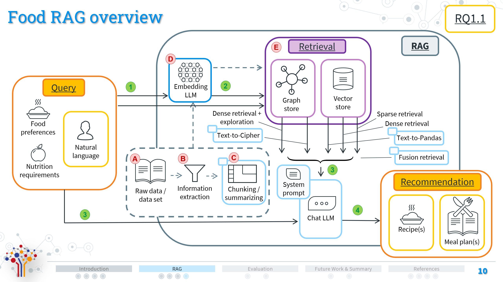
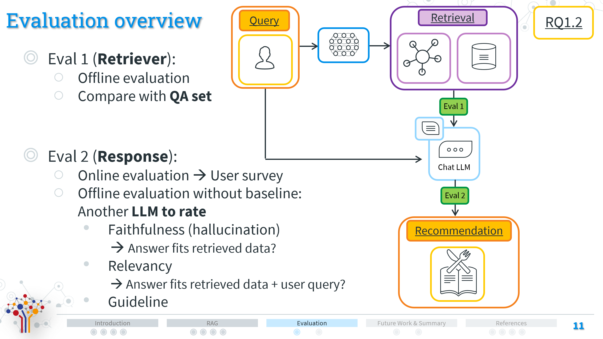

# Food RAG

Repository of the food RAG system based on the HUMMUS KG [[1](#1)].
The system is based/uses LlamaIndex [[2](#2)] and Nebula Graph [[3](#3)].

## Installation & Usage:

1. Clone the repository
2. Install python 3.11.9 (preferably with conda)
3. Install the requirements with `pip install -r requirements.txt`
4. Preprocess the data
    1. Download the [HummusKG dataset](https://gitlab.com/felix134/connected-recipe-data-set)
    2. Extract the dataset and provide its path in all to-be-used Jupyter Notebooks. Note: The files from steps "b." and "c." must be downloaded from tertiary sources as HUMMUS is based on them but they are not published by HUMMUS. The following variables are only required once when initializing the data (an init code example is found in `create_embeddings.ipynb`):
        1. The variable `data_location` points to the raw dataset from food.com, namely `members.csv`, `recipes.csv`,
           and `reviews.csv`.
        2. The variable `graph_location` points to the original FoodKG [[4](#4)] requiring the FoodOntology [[6](#6)] and USDA/FoodData [[7](#7)] files.
        3. The variable `additional_location` points to the additional files including tag information [[5](#5)] (Also available at https://www.kaggle.com/shuyangli94/food-com-recipes-and-user-interactions).
    3. Create a question-answer dataset for retriever evaluation later on
       1. Execute `qa_generation_1.ipynb` to create a question-answer dataset for evaluation (has to be done only once). For
          the second question-answer dataset, including only ingredient class requirements (instead of direct inferred
          ingredients), execute `qa_generation_2.ipynb`.
       2. The question-answer dataset will be saved in the `data/qa` folder
    4. Execute `create_embeddings.ipynb` to preprocess the embeddings (has to be done only once). Here, we also init the HUMMUS data.
    5. Initialize the stores:
        1. Execute `init_vector_store.ipynb` to preprocess the db (has to be done only once)
        2. Execute `init_graph_store_1.ipynb` and optionally `init_graph_store_2.ipynb` to preprocess the KGs (has to be done only
           once, and only for the desired graphs)
    6. The preprocessed Hummus KG will be saved in the `data/hummus` folder, the Nebula KG in the `data/nebula_kg`
       folder, the graph store in the `data/graph_store` folder, and the embeddings in the  `data/embeddings` folder
5. Run the Food RAG system by following the notebook's instructions: `food_RAG_agents.ipynb`.
6. For the complete evaluation refer to the `eval_1.ipynb` and the `eval_2.ipynb` notebooks. The evaluation results will be saved in the `data/runs`
   folder. Alternatively, you can run the evaluation script with `python eval_1.py`.

## System Overview

## Evaluation Overview

# Resources

[<a id="1">1</a>] Felix Bölz, Diana Nurbakova, Sylvie Calabretto, Armin Gerl, Lionel Brunie, and Harald Kosch. 2023.
HUMMUS: A Linked, Healthiness-Aware, User-centered and Argument-Enabling Recipe Data Set for Recommendation. In
Proceedings of the 17th ACM Conference on Recommender Systems (RecSys '23). Association for Computing Machinery, New
York, NY, USA, 1–11. https://doi.org/10.1145/3604915.3609491

[<a id="2">2</a>] LlamaIndex Repository. https://docs.llamaindex.ai/en/stable/

[<a id="3">3</a>]  Nebula Graph Repository. https://www.nebula-graph.io/

[<a id="4">4</a>] Haussmann, S., Seneviratne, O., Chen, Y., Ne’eman, Y., Codella, J., Chen, C. H., … Zaki, M. J. (2019). FoodKG: A
Semantics-Driven Knowledge Graph for Food Recommendation. In Lecture Notes in Computer Science (including subseries
Lecture Notes in Artificial Intelligence and Lecture Notes in Bioinformatics) (Vol. 11779 LNCS, pp. 146–162).
Springer. https://doi.org/10.1007/978-3-030-30796-7_10

[<a id="5">5</a>] Majumder, B. P., Li, S., Ni, J., & McAuley, J. (2019). Generating personalized recipes from historical user
preferences. In EMNLP-IJCNLP 2019 - 2019 Conference on Empirical Methods in Natural Language Processing and 9th
International Joint Conference on Natural Language Processing, Proceedings of the Conference (pp. 5976–5982).
Association for Computational Linguistics. https://doi.org/10.18653/v1/d19-1613

[<a id="6">6</a>] Dooley, D.M., Griffiths, E.J., Gosal, G.S. et al. FoodOn: a harmonized food ontology to increase global food traceability, quality control and data integration. npj Sci Food 2, 23 (2018). https://doi.org/10.1038/s41538-018-0032-6

[<a id="7">7</a>] SR Legacy Food, https://fdc.nal.usda.gov/